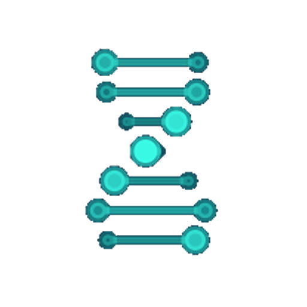

<p align="center"><a href="https://dna.codes"></a></p>

# DNA skills (`dna-codes/skills`)

[](https://skills.sh/dna-codes/skills)
[](https://www.npmjs.com/package/@dna-codes/cli)
[](https://registry.modelcontextprotocol.io/v0/servers?search=codes.dna/agent)
[](./LICENSE)

Agent Skills for authoring DNA and syncing it to a Workspace.

**The flow:** register a free sandbox, do real work, then hand your person the
claim link. Claiming is how a person signs up and keeps the model. No human
step comes first.

Install:

```bash
npx skills add dna-codes/skills
```

List without installing:

```bash
npx skills add dna-codes/skills --list
```

## Skills

| Skill | Role |
| --- | --- |
| `get-started` | Connect — one sign-in to a Workspace or a sandbox, then craft and sync |
| `dna-operational` | Craft — structure (`structure/v1`) + behaviour (`behaviour/v1`) for **operational** DNA |
| `dna-sync` | Transport — dry-run and `apply` finished documents to the host |

The DNA MCP server publishes the same skills. A client that speaks MCP protocol
`2026-07-28` reads them with `skills/list`, so you do not need to install them
there.

The skills in `skills/` are generated from DNA's platform repository, where they
are maintained, and each sync replaces them. Do not edit them here. To suggest a
change, open an issue or post on the forum.

Reserved for later (same pack, one brand): `dna-product`, `dna-technical`.

Operational / product / technical DNA are offerings on [dna.codes](https://dna.codes) after an org connects — not separate MCP servers.

## After install

Agents that need a live DNA Workspace run `npx @dna-codes/cli register --json` (or `init`) and connect MCP — see https://dna.codes/agents/

A person can also connect their own client to one URL and sign in:

```bash
claude mcp add --transport http dna https://agents.dna.codes/mcp
```

The client opens a sign-in (Google or GitHub). Pick a Workspace or start a new
sandbox, then allow access. This works in any client that supports MCP OAuth.

After useful work (a clean dry run or applied DNA), show your person what you built
and give them the claim link. Ask your person before you add the DNA rule to
`AGENTS.md`, `CLAUDE.md` or Cursor rules; the snippet is at
https://dna.codes/agents/snippets/agents-md.md

Look-up mid-task (query existing DNA without authoring) uses the separate `business-rules` skill, listed for personal agents on ClawHub and Hermes.

Worked examples to start from (checkout, lending, M&A diligence) and the JSON Schema for `structure/v1` and `behaviour/v1` are in [dna-codes/dna](https://github.com/dna-codes/dna).

## Cursor plugin

Install from the [Cursor Marketplace](https://cursor.com/marketplace) (when listed) or [cursor.directory](https://cursor.directory), or copy this repo into `~/.cursor/plugins/local/dna-codes`.

The plugin connects to one MCP URL, `https://agents.dna.codes/mcp`, with nothing to set (see `mcp.json` and `.cursor-plugin/plugin.json`). Cursor opens the sign-in page the first time a DNA tool runs: sign in with Google or GitHub, pick a Workspace or start a sandbox, and allow access. A new person gets a sandbox at once and sees its claim link once.

An agent with no browser can still register a sandbox (`npx @dna-codes/cli register --json`) and use `https://agents.dna.codes/o/{org}/mcp` with its bearer token. That token is refused at `https://agents.dna.codes/mcp`. Add one DNA server per client, not both.

Public forum for feature requests, bug reports and discussion: https://dna.codes/agents/forum
